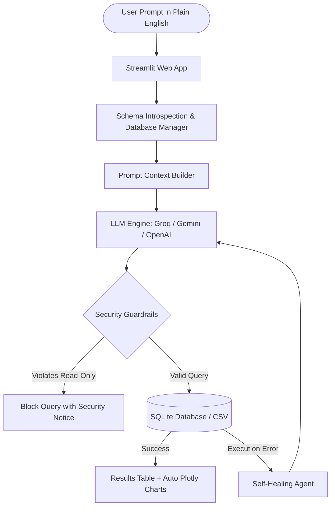

# ⚡ SQLCraft: Plain English to SQL Generator

[](https://www.python.org/)
[](https://streamlit.io/)
[](https://groq.com/)
[](tests/)
[](LICENSE)

A production-grade GenAI web application that translates natural language English questions into optimized, syntactically verified SQL queries, executes them in real-time, generates dynamic Plotly visualizations, and incorporates an agentic self-healing loop for error correction.

---

## 📸 Key Features

- **🌐 Interactive Web Dashboard**: Built with Streamlit, providing an intuitive interface for querying data, exploring schemas, and visualizing results.
- **⚡ Multi-Provider LLM Engine**: Seamless integration with **Groq** (ultra-fast inference), **Google Gemini**, and **OpenAI**.
- **🔍 Dynamic Schema Introspection**: Extracts table definitions, data types, primary/foreign key relationships, and row previews on-the-fly.
- **🛡️ Security Guardrails**: Strict read-only mode blocking destructive SQL operations (`DROP`, `DELETE`, `UPDATE`, `INSERT`, `ALTER`, `TRUNCATE`).
- **🩹 Agentic Self-Healing Loop**: If a query encounters a database execution error, the AI automatically diagnoses the failure, inspects the schema, fixes the SQL, and re-executes.
- **📊 Real-time Execution & Visualizations**: Executes queries against SQLite in sub-milliseconds, displays interactive dataframes, and automatically renders Plotly charts (bar, line).
- **📂 Flexible Data Sources**:
  - Pre-loaded **Enterprise Demo Database** (Customers, Orders, Products, Employees, Departments, Order Items).
  - Upload custom SQLite databases (`.db`, `.sqlite`).
  - Upload any `.csv` file to convert into a queryable SQL table on-the-fly.
- **📥 One-Click Export**: Export execution results to CSV and copy formatted SQL queries with syntax highlighting.

---

## 🏛️ Architecture Overview



---

## 🚀 Quick Start Guide

### 1. Clone the Repository
```bash
git clone https://github.com/<your-username>/english-to-sql-generator.git
cd english-to-sql-generator
```

### 2. Set Up Virtual Environment
```bash
# Windows
python -m venv .venv
.\.venv\Scripts\activate

# macOS / Linux
python3 -m venv .venv
source .venv/bin/activate
```

### 3. Install Dependencies
```bash
pip install -r requirements.txt
```

### 4. Configure Environment Variables
Copy the `.env.example` file to `.env` and insert your API key:
```bash
cp .env.example .env
```
Edit `.env`:
```env
# Free ultra-fast API key from https://console.groq.com/keys
GROQ_API_KEY=your_groq_api_key_here
DEFAULT_PROVIDER=groq
GROQ_MODEL=openai/gpt-oss-120b
```

### 5. Launch the Web Application
```bash
streamlit run app.py
```
Open your browser at `http://localhost:8501`.

---

## 💡 Example Queries to Try

- **Top Customers**: *"What are the top 3 highest spending customers with their total spent?"*
- **Department Metrics**: *"List all departments with their average employee salary ordered from highest to lowest."*
- **Inventory Check**: *"Show products with stock quantity less than 35 and unit price greater than 100."*
- **Sales Analytics**: *"Count the number of orders and total revenue for each order status."*
- **Advanced Filtering**: *"Find all employees hired after 2022 who earn more than 90,000 in the Engineering department."*

---

## 📁 Project Structure

```text
english-to-sql-generator/
├── .github/
│   └── workflows/
│       └── ci.yml               # GitHub Actions CI workflow
├── data/
│   └── sample_enterprise.db    # Relational demo database (SQLite)
├── src/
│   ├── __init__.py
│   ├── config.py                # Environment and app configuration
│   ├── database/
│   │   ├── __init__.py
│   │   ├── db_manager.py        # Schema introspection, query execution, CSV loading
│   │   └── sample_data.py       # Enterprise database seed generator
│   └── llm/
│       ├── __init__.py
│       ├── guardrails.py        # SQL syntax validation and read-only security
│       ├── prompts.py           # Dialect instructions, few-shot templates
│       ├── self_healing.py      # Error repair agent loop
│       └── sql_generator.py     # Multi-provider LLM interface (Groq, Gemini, OpenAI)
├── tests/
│   ├── __init__.py
│   ├── test_db_manager.py       # Database and CSV loader tests
│   ├── test_guardrails.py       # Security guardrail tests
│   └── test_sql_generator.py    # LLM response parser tests
├── .env.example                 # Example configuration template
├── .gitignore                   # Ignored files (venv, keys, caches)
├── app.py                       # Streamlit web application entry point
├── requirements.txt             # Project dependencies
└── README.md                    # Project documentation
```

---

## 🧪 Running Unit Tests

Run the comprehensive test suite with `pytest`:
```bash
pytest -v
```

All 17 tests verify schema parsing, query execution, CSV ingestion, guardrails, and LLM output parsing.

---

## 📄 License
This project is licensed under the MIT License. See [LICENSE](LICENSE) for details.
